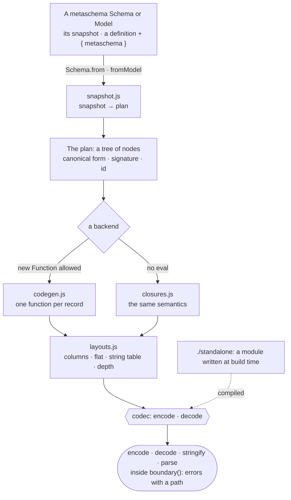
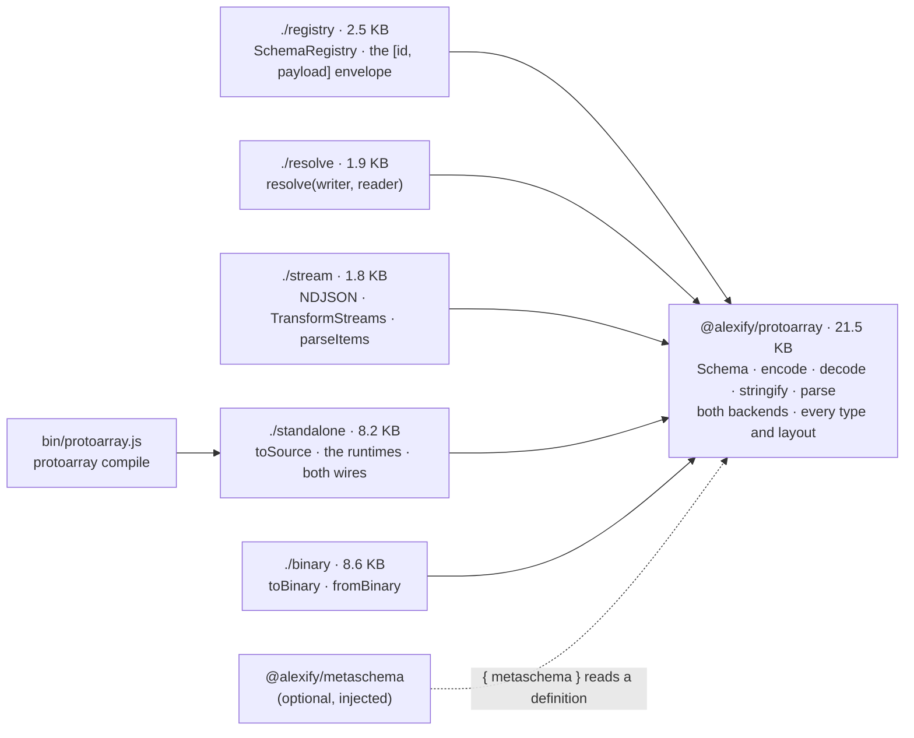
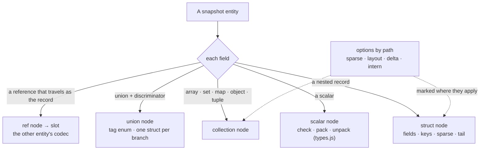
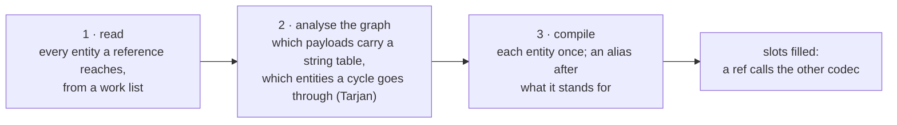
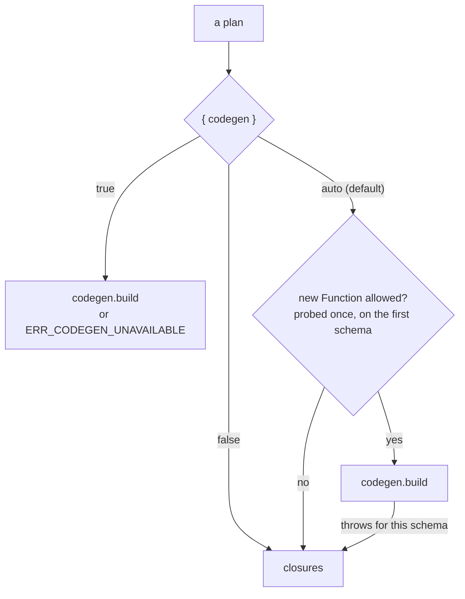
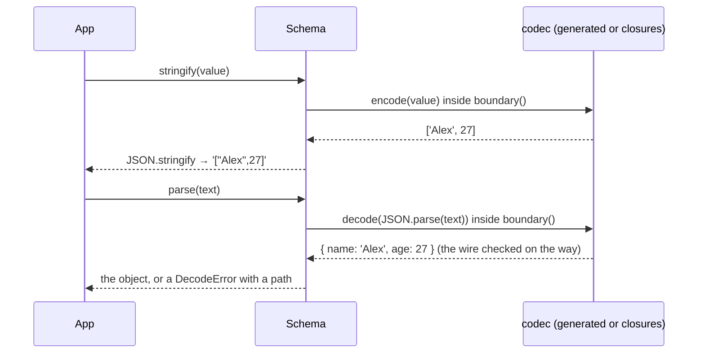
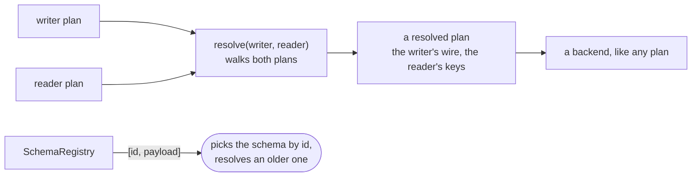
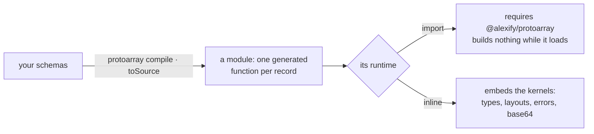

# Architecture

protoarray is a library: a schema is an object in your process, built once from a source, and
every `encode` and `decode` is a function call on it. This page follows a source from the object
you pass to `Schema.from` to the functions that write and read the wire, then a call through
them, and maps each step to the module that does it. The topic pages go deeper; the links say
where.

## The big picture

A schema reads its source once, when it is built: the snapshot becomes a **plan**, a tree of
nodes that says what travels at each position, and a backend compiles the plan into an `encode`
and a `decode`. Nothing is read from the source afterwards, and nothing global is touched by a
call. The plan also gives the schema its canonical form and its id, which is how two peers tell
whether they speak the same version.

## The packages

The core entry encodes and decodes; what a program needs only sometimes is a subpath that
requires the core and registers nothing until it is asked to.

The sizes are min+gzip, a subpath measured as what it adds to the core. Each subpath exports free
functions with the schema first and a `register()` that installs them as methods; nothing in the
core requires a subpath, so a bundler drops the ones a program does not import. metaschema is never
required: a schema built from a metaschema object calls its public methods, and a raw definition is
read by the metaschema module the caller passes in.

| Layer | Modules (under `src/`) | Responsibility |
| --- | --- | --- |
| [Sources](/guide/schema) | `schema.js` | the `Schema` class: sources, options, the assembly of a snapshot's entities, plan → backend |
| [The plan](/guide/wire-format) | `snapshot.js`, `plan.js` | a metaschema snapshot read into nodes, the options by path, the canonical form, the id |
| [Types](/guide/types) | `types.js` | the scalar types: checks, conversions to and from the wire, interned strings, delta lists |
| [Backends](/guide/runtimes) | `codegen.js`, `closures.js` | generated code (the only file that compiles source text) and the no-eval twin |
| [Layouts](/guide/collections) | `layouts.js` | `flat` and `columns`, delta columns, the string table of a message, the depth guard |
| [Errors](/guide/errors) | `errors.js`, `codec.js` | `EncodeError` and `DecodeError` with a path, the boundary of a call, the free functions |
| Subpaths | `registry.js`, `resolve.js`, `stream.js`, `standalone.js` | each bundled only where it is imported |
| [Platform](/guide/runtimes) | `runtime/node.js`, `runtime/browser.js` | base64 for `bytes`: `Buffer` in Node.js, the platform's own in browsers |

## From a source to a plan

Every source comes down to a metaschema snapshot (format 1): a `Schema` writes its
`toSnapshot()`, a `Model` its `toJSON()`, a definition is read by the injected metaschema first,
and a snapshot is used as it is. `snapshot.js` reads it into nodes.

A struct node keeps its fields in declaration order, which is the order on the wire, and `tail`,
the index where the trailing run of optional fields starts: the only part that may be trimmed off
the wire. The options that shape the wire name their places by path (`'[].address.city'`); the
reader marks each place it meets and reports a path that names none, so a typo is an error and not
a silent no-op. The snapshot is untrusted input: every form is checked, nesting is limited,
`__proto__` and integer-like keys are refused.

## Entities and references

A snapshot can hold several entities that reference each other, a recursion among them. They are
built together, in three steps, so a chain of references is a loop and not a recursion of the
builder:

A reference becomes a **slot**, a placeholder until the referenced entity is compiled, and both
backends call through it. A collection inside a record with a layout of its own is compiled as a
root of its own and called through a slot too, and so is the item codec of `schema.list`. With
`maxDepth`, the codec of an entity a recursion goes through counts its levels and refuses past the
limit; without it, nothing is wrapped and a stack overflow becomes a `DecodeError`.

## Two backends, one wire

The generated code writes array and object literals, so every decoded object has the hidden class
a literal of the schema's keys would, and the engine keeps the call sites monomorphic. The
closures compose the same steps without compiling anything; a decoded object starts as a copy of a
template with the schema's keys at their defaults, which keeps its hidden class stable too and
makes a missing field free. The two backends are
indistinguishable on the outside: the same wire, the same objects in the same key order and the
same errors, which a property-based suite checks on random schemas, values and corrupted wires.
Schema keys reach generated source only as `JSON.stringify(key)`, and generated code gets every
helper through its parameters, so a minifier cannot break it.

## A call

`encode` trusts its values: it checks only what the wire is built from (a shape, a union's
discriminator, the values of a list of differences), and validating the values is metaschema's,
on the same definition. `decode` checks the wire by default. Paths like `orders[1].sku` are built
only on error branches: generated code embeds the static keys and loop indices in its `throw`, and
nested calls re-throw through `nest()`, which prepends a step. `boundary()` puts the schema's
name on the error, writes its path once, and turns a stack overflow into a `depth` error. For a
record of converted types, `stringify` can write the JSON text while it encodes, without the
intermediate array (see [Runtimes](/guide/runtimes#how-stringify-writes-the-text)).

## Ids and versions

The plan has a canonical form, a string that describes the wire and is the same for two schemas that
write the same one: `schema.toString()`. A schema's **signature** is that form followed by the
canonical form of every other entity it reaches by reference, and `schema.id` is its fingerprint
(FNV-1a, 32 or 64 bits as the `fingerprint` option names, or your own function of it), so a
changed referenced entity changes the id.
For a schema without references, these are the strings and ids 1.x computed from its own spelling of
the definition.

[`resolve`](/guide/resolve) walks a writer's plan and a reader's plan together into a third plan:
each field of the writer's wire, in its order, with the reader's key, default and conversion, and
the reader's fields the writer lacks. It is compiled like any other plan, so reading an old
payload into the current shape costs one generated function. A registry keeps the schemas of a
program by id and writes each payload as `[id, payload]`.

## Standalone modules

[`toSource`](/guide/standalone) writes the generated code of a schema into a module, with each
helper as the expression that makes it again and each slot as a lazy reference to another schema
of the module. `errors.js`, `types.js`, `layouts.js` and the browser half of the base64 runtime are
closed functions, run once, so their source can be embedded: an `inline` module needs nothing but
the platform and calls no `new Function`, which is what a strict CSP or an edge runtime allows.

## Platform

Nothing under `src/` requires a Node builtin except `src/runtime/node.js`; the `browser` field of
`package.json` maps it to `src/runtime/browser.js`, so the same code runs in Node.js and browsers.
Generated code lives in `src/codegen.js` alone. The test suite enforces both, bundles the browser
entry and runs it minified in a separate realm, with and without generated code.
